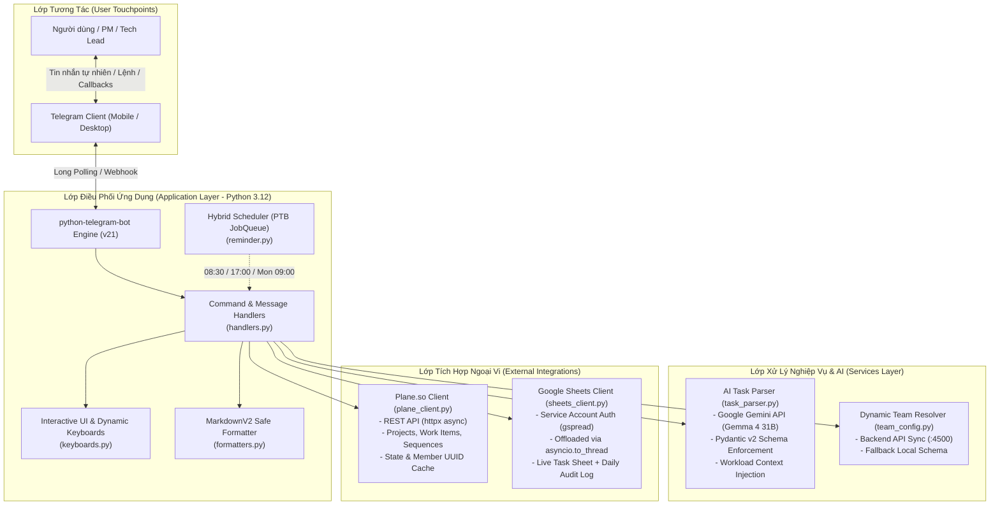
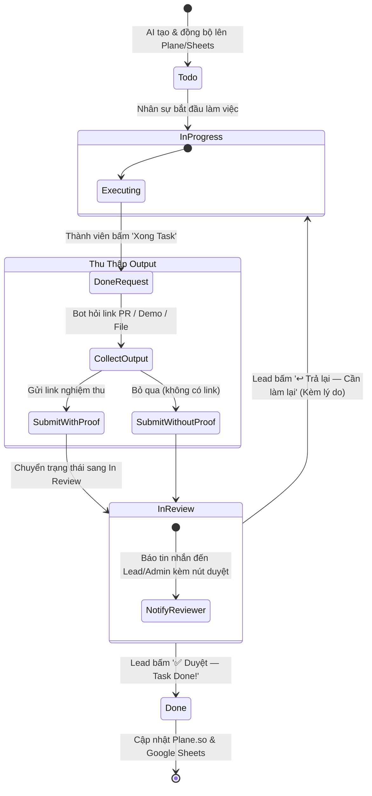

<div align="center">

# 🤖 AI Task Manager Bot

**Hệ thống điều phối & quản lý công việc tự động qua Telegram kết hợp AI (Gemma / Gemini), Plane.so và Google Sheets Dashboard.**

[](https://www.python.org/)
[](https://python-telegram-bot.org/)
[](https://aistudio.google.com/)
[](https://plane.so/)
[](https://developers.google.com/sheets/api)
[](https://www.docker.com/)

[Tính Năng](#-tính-năng-nổi-bật) • [Kiến Trúc](#-kiến-trúc-hệ-thống) • [Luồng Nghiệp Vụ](#-luồng-duyệt--phê-duyệt-task-state-machine) • [Bài Toán Kỹ Thuật](#-những-bài-toán-kỹ-thuật-đã-giải-hard-engineering-problems) • [Cài Đặt & Triển Khai](#-hướng-dẫn-cài-đặt--triển-khai) • [Lệnh Bot](#-danh-mục-lệnh-bot-command-reference)

</div>

---

## 📌 1. Tổng Quan & Giá Trị Thực Tiễn (Business Impact)

Trong môi trường startup và các đội ngũ kỹ thuật năng động tại Việt Nam, việc quản lý công việc thường gặp phải các rào cản:
1. **Mất thời gian tạo task thủ công:** Quản lý phải ngồi gõ từng task, chia sub-tasks, ước lượng giờ (estimate), gán deadline trên Jira/Plane.
2. **Trôi tin nhắn & quên việc:** Yêu cầu bàn giao thường trao đổi qua Telegram nhưng không được đồng bộ tức thì vào hệ thống quản lý tập trung.
3. **Spam thông báo gây mệt mỏi (Notification Fatigue):** Các bot thông thường hay tag cả nhóm mỗi khi có cập nhật, dẫn đến việc tắt thông báo (mute) và bỏ lỡ deadline thật.

**AI Task Manager Bot** giải quyết triệt để vấn đề này bằng cách kết hợp **ngôn ngữ tự nhiên tiếng Việt** với mô hình ngôn ngữ lớn (Gemma 4 31B qua Google Gemini API):
- Người dùng chỉ cần gửi một dòng tin nhắn bình thường trên Telegram (ví dụ: *"Làm trang checkout tích hợp VNPay, cần UI chuẩn và test, deadline thứ 6"*).
- Bot tự động phân rã thành **2 – 8 sub-tasks chi tiết**, đề xuất nhân sự thực hiện phù hợp nhất dựa trên kỹ năng (skills) và khối lượng công việc hiện tại (workload balancing), tính toán thời gian và chỉ rõ sản phẩm bàn giao (deliverables).
- Đồng bộ đa điểm hai chiều: Tạo Work Item trên **Plane.so** và ghi nhận thời gian thực lên **Google Sheets Dashboard**.
- Cơ chế **Hybrid Reminder**: Nhắn tin riêng (DM) nhắc việc từng cá nhân + Báo cáo tổng quan im lặng vào nhóm chung, loại bỏ 100% spam.

---

## 🏛️ 2. Kiến Trúc Hệ Thống (System Architecture)

Hệ thống được thiết kế theo kiến trúc module hóa hướng sự kiện bất đồng bộ (**Async Event-Driven Modular Architecture**):



---

## 🔄 3. Luồng Duyệt & Phê Duyệt Task (State Machine)

Hệ thống áp dụng mô hình phân cấp 3 tầng rõ ràng:  
**Dự Án (OmniProject) $\rightarrow$ Task Tổng (OmniTask) $\rightarrow$ Sub-Task Cụ Thể (SubTask)**.

Quy trình vòng đời của từng sub-task diễn ra qua máy trạng thái nghiêm ngặt (**Dual-Loop Review Flow**):



### Chi tiết các bước duyệt:
1. **Check-in & Bắt đầu:** Khi thành viên bấm nhận task hoặc cập nhật trạng thái sang `In Progress`.
2. **Báo cáo hoàn thành:** Thành viên chọn `/done` hoặc click nút inline. Bot hiển thị menu hỏi có tài liệu/link kiểm chứng (PR GitHub, Figma link, URL deploy, tài liệu doc) hay không.
3. **Chuyển giao thẩm định (`In Review`):** 
   - Task được đẩy vào hàng chờ review `_pending_reviews`.
   - Bot lập tức gửi thông báo đến **Telegram Admin/Lead** với đầy đủ thông tin: Người làm, thời gian bàn giao, link chứng minh và 2 nút hành động trực tiếp.
4. **Quyết định (Approve / Reject):**
   - **Approve:** Đổi trạng thái sang `Done` trên Plane.so, tô xanh trên Google Sheets và gửi tin chúc mừng cho người làm.
   - **Reject:** Đổi trạng thái ngược lại `In Progress`, yêu cầu chỉnh sửa và thông báo lý do rõ ràng về tin nhắn riêng của nhân sự.

---

## 🧠 4. Những Bài Toán Kỹ Thuật Đã Giải (Hard Engineering Problems)

### 4.1. Non-Blocking Async Event Loop với Synchronous Third-Party SDKs
* **Vấn đề:** Thư viện `google-genai` (khi gọi đồng bộ) và `gspread` (Google Sheets) đều là thư viện blocking I/O đồng bộ. Nếu gọi trực tiếp bên trong async handler của `python-telegram-bot`, toàn bộ luồng sự kiện (event loop) của bot sẽ bị đơ, khiến bot không phản hồi tin nhắn của các người dùng khác.
* **Giải pháp:** Sử dụng cơ chế `asyncio.to_thread()` bọc toàn bộ các lời gọi API nặng (Gemini API, Google Sheets I/O) chạy trong ThreadPool ngầm:
  ```python
  # Non-blocking async execution
  response = await asyncio.to_thread(
      self._client.models.generate_content,
      model=self._model,
      contents=full_user_message,
      config=config,
  )
  ```
  Nhờ đó, bot duy trì thời gian phản hồi giao diện tức thì ($< 50\text{ms}$) ngay cả khi đang đồng bộ hàng chục dòng dữ liệu lên Google Sheets.

### 4.2. Khử Ảo Giác Bằng Pydantic Structured Output & Workload Injection
* **Vấn đề:** LLM khi phân tích văn bản tự do dễ bị ảo giác (hallucination), trả về định dạng JSON sai lệch hoặc gán task cho nhân sự không có kỹ năng liên quan.
* **Giải pháp:**
  - Định nghĩa chặt chẽ Schema bằng **Pydantic v2** (`TaskBreakdown`, `SubTask`, `Priority`).
  - Tiêm ngữ cảnh nhân sự động (**Dynamic Context Injection**): Trước khi phân tích, hệ thống tự động tổng hợp danh sách kỹ năng của từng thành viên và số lượng task đang tồn đọng đưa vào system prompt.
  - LLM vừa tối ưu việc chọn đúng chuyên môn, vừa tự động cân bằng tải (workload balancing) — ưu tiên người ít việc hơn khi có nhiều người cùng kỹ năng.

### 4.3. Kiến Trúc Nhắc Việc Lai (Hybrid Non-Spam Reminder)
* **Vấn đề:** Thông báo bot trong nhóm chung thường bị trôi hoặc gây phiền (noise). Ngược lại, nếu chỉ gửi tin nhắn riêng thì thiếu tính minh bạch giữa các thành viên.
* **Giải pháp:** Phân luồng thông minh theo thời gian:
  - **08:30 Sáng (Daily Kickoff):**
    - **Nhóm chung:** Gửi bản tin tóm tắt ngắn gọn số task mở/quá hạn với cờ `disable_notification=True` (im lặng, không reo chuông).
    - **Tin nhắn riêng (DM):** Gửi danh sách task chi tiết từng người kèm deadline cho cá nhân đó.
  - **17:00 Chiều (Deadline Radar):** Chỉ kích hoạt gửi DM riêng cho những ai có task quá hạn hoặc đến hạn trong ngày để nhắc nhở khẩn trương bàn giao.
  - **09:00 Thứ Hai (Weekly Recap):** Tổng kết tuần hiệu suất hoàn thành trên kênh chung.

### 4.4. Tự Động Lưu Cache & Khôi Phục Kết Nối (Resilient Caching)
* **Plane Client** tự động cache `UUID` của thành viên và các `State ID` (`Todo`, `In Progress`, `Done`) để tránh gọi API lặp lại.
* **Dynamic Team Sync:** Tự động kết nối tới backend nội bộ (`:4500/api/omnitask/team-members`). Nếu server nội bộ bảo trì hoặc mất kết nối, hệ thống tự động fallback về cấu hình cục bộ mà không gián đoạn hoạt động của Bot.

---

## ⚡ 5. Tính Năng Nổi Bật (Core Features)

| Tính Năng | Mô Tả Kỹ Thuật Chi Tiết |
|:---|:---|
| 📝 **Nhận diện tự nhiên** | Nhận mô tả dự án bằng tiếng Việt tự nhiên qua tin nhắn thường hoặc lệnh `/newtask`. |
| 🤖 **AI Task Breakdown** | Tự động chia nhỏ 2–8 sub-tasks, gán estimated hours, deadline và deliverables cụ thể. |
| 👥 **Workload Balancing** | Tự động đọc danh sách task đang mở để phân bổ công việc đồng đều, tránh quá tải. |
| 📁 **Hierarchy 3 tầng** | Quản lý logic theo Dự án $\rightarrow$ Task $\rightarrow$ Sub-task, hỗ trợ chọn hoặc tạo dự án mới trực tiếp. |
| 📌 **Sync Plane.so** | Tự động tạo work item trên Plane, tạo liên kết trực tiếp để dev click mở ngay. |
| 📊 **Dashboard Google Sheets** | Đồng bộ tự động 2 bảng: `Tasks` (danh sách công việc) và `Daily Log` (nhật ký vận hành). |
| 🔄 **Quy trình Duyệt 2 Chiều** | Bàn giao kèm link chứng minh (PR/Figma) $\rightarrow$ Lead duyệt hoặc trả lại kèm lý do. |
| ⏰ **Nhắc việc thông minh** | Sáng 8:30 (Kickoff), Chiều 17:00 (Deadline warning), Thứ Hai 9:00 (Weekly summary). |
| 🐳 **Dockerized SRE** | Chạy độc lập trong container, giới hạn 256MB RAM, người dùng non-root, có sẵn Healthcheck. |

---

## 📱 6. Danh Mục Lệnh Bot (Command Reference)

### 6.1. Các Lệnh Điều Khiển Chính
| Lệnh | Phím Tắt | Mô Tả & Hành Động |
|:---|:---|:---|
| `/start` | — | Khởi động bot, tự động lưu `chat_id` Telegram của người dùng, hiển thị menu chính. |
| `/newtask <mô tả>` | `➕ Tạo Task mới` | Nhập mô tả công việc để AI phân tích và hiển thị bản thảo breakdown. |
| `/tasks` | `📋 Xem tasks` | Xem toàn bộ danh sách task đang mở, nhóm theo từng thành viên trong team. |
| `/mytasks` | `👤 Task của tôi` | Xem danh sách các task được phân công cho chính bạn (match qua username). |
| `/done` | — | Báo cáo hoàn thành một task, kích hoạt luồng nộp link chứng minh và gửi duyệt. |
| `/projects` | `📁 Dự án` | Xem danh sách các dự án đang hoạt động và tiến độ tổng thể. |
| `/team` | `👥 Team` | Xem danh sách thành viên, kỹ năng và số lượng task đang đảm nhiệm. |
| `/remind` | `📊 Báo cáo ngay` | Kích hoạt ngay lập tức chu kỳ báo cáo tiến độ và gửi thông báo nhắc việc. |
| `/sync` | — | Đồng bộ toàn diện dữ liệu từ Plane.so sang Google Sheets thủ công. |
| `/help` | — | Hiển thị tài liệu hướng dẫn và danh sách cú pháp chi tiết. |

### 6.2. Minh Họa Quy Trình Tạo Task Bằng AI
```text
User: 
"Làm tính năng đăng nhập SSO Google cho mobile app, cần UI theo chuẩn Material, 
API xác thực JWT, và viết unit test. Deadline thứ 5 tuần tới."

Bot (Gemma 4 31B Phân Tích):
━━━━━━━━━━━━━━━━━━━━━━━━━━━━━━━━━━━━
🤖 ĐỀ XUẤT PHÂN CHIA CÔNG VIỆC TỪ AI
Dự án: Tích hợp Google SSO Mobile App
Tổng thời gian ước tính: 18 giờ
━━━━━━━━━━━━━━━━━━━━━━━━━━━━━━━━━━━━
1. Thiết kế UI màn hình đăng nhập Google
   👤 Phụ trách: Linh (Frontend Developer)
   ⏱ Ước tính: 4 giờ | 📅 Deadline: 3 ngày
   📦 Deliverables: Component giao diện Flutter/React Native, mockup preview
   🏷 Độ ưu tiên: 🟠 Cao

2. Xây dựng API xác thực JWT & Google OAuth Backend
   👤 Phụ trách: Huy (Backend Developer)
   ⏱ Ước tính: 8 giờ | 📅 Deadline: 5 ngày
   📦 Deliverables: Endpoint /auth/google, JWT token verification, Swagger doc
   🏷 Độ ưu tiên: 🔴 Khẩn cấp

3. Viết Unit Test & Kiểm thử End-to-End
   👤 Phụ trách: Nam (Full Stack Developer)
   ⏱ Ước tính: 6 giờ | 📅 Deadline: 6 ngày
   📦 Deliverables: Test suite coverage > 85%, Postman collection
   🏷 Độ ưu tiên: 🟡 Trung bình

[✅ Xác nhận & Tạo task]   [✏️ Chỉnh sửa]   [❌ Hủy]
```

---

## 📊 7. Cấu Trúc Google Sheets Dashboard

Hệ thống tự động khởi tạo và cập nhật 2 trang tính (worksheet):

### Sheet 1: `Tasks` (Quản trị chi tiết)
| Cột | Tên Tiêu Đề | Ví Dụ Dữ Liệu |
|:---|:---|:---|
| A | **Task ID** | `TSK-104` |
| B | **Tiêu đề** | Thiết kế UI màn hình đăng nhập Google |
| C | **Người phụ trách** | Linh |
| D | **Độ ưu tiên** | `🟠 Cao` |
| E | **Trạng thái** | `In Progress` |
| F | **Deadline** | `2026-10-15` |
| G | **Ước tính (giờ)** | `4` |
| H | **Deliverables** | Component Flutter, UI Preview |
| I | **Link Plane** | `https://app.plane.so/workspace/projects/...` |
| J | **Ngày tạo** | `2026-10-09 14:30` |
| K | **Cập nhật lần cuối**| `2026-10-09 16:15` |

### Sheet 2: `Daily Log` (Nhật ký tự động hóa)
| Cột | Tên Tiêu Đề | Ví Dụ Dữ Liệu |
|:---|:---|:---|
| A | **Thời gian** | `2026-10-09 08:30:00` |
| B | **Loại** | `Morning Reminder` |
| C | **Nội dung** | Đã gửi DM cho 4 thành viên, gửi summary nhóm chung |
| D | **Tasks mở** | `12` |
| E | **Tasks quá hạn** | `1` |

---

## 📂 8. Cấu Trúc Thư Mục Dự Án (Project Layout)

```text
AI-Task-Manager/
├── .github/                       # GitHub prompts & workflow templates
├── src/                           # Mã nguồn chính của ứng dụng
│   ├── __init__.py
│   ├── config.py                  # Cấu hình Pydantic Settings đọc từ .env
│   ├── team_config.py             # Cấu hình nhân sự, đồng bộ backend dynamic
│   │
│   ├── agent/                     # Tầng giao diện Telegram Bot
│   │   ├── __init__.py
│   │   ├── bot.py                 # Entry point khởi động Telegram Application
│   │   ├── handlers.py            # Xử lý tất cả lệnh, tin nhắn & callback queries
│   │   ├── keyboards.py           # Thiết kế bàn phím inline & reply menu
│   │   └── formatters.py          # Chuẩn hóa văn bản sang Telegram MarkdownV2
│   │
│   ├── ai/                        # Tầng trí tuệ nhân tạo (AI Engine)
│   │   ├── __init__.py
│   │   └── task_parser.py         # Tích hợp Google Gemini (Gemma 4 31B)
│   │
│   ├── integrations/              # Tầng kết nối dịch vụ bên thứ ba
│   │   ├── __init__.py
│   │   ├── plane_client.py        # Client Plane.so REST API (httpx async)
│   │   └── sheets_client.py       # Client Google Sheets API (gspread)
│   │
│   ├── models/                    # Data models chuẩn hóa
│   │   ├── __init__.py
│   │   └── task.py                # Pydantic v2 schemas: Task, Member, Breakdown
│   │
│   └── scheduler/                 # Tầng lập lịch tự động
│       ├── __init__.py
│       └── reminder.py            # Hybrid Reminder (APScheduler / JobQueue)
│
├── Dockerfile                     # Docker container tối ưu (Python 3.12-slim)
├── docker-compose.yml             # Cấu hình triển khai production với resource limit
├── requirements.txt               # Danh sách thư viện phụ thuộc đã khóa version
├── .env.example                   # Mẫu biến môi trường tiêu chuẩn
└── README.md                      # Tài liệu hướng dẫn toàn diện
```

---

## 🚀 9. Hướng Dẫn Cài Đặt & Triển Khai (Setup & Deployment)

### 9.1. Chuẩn Bị Thông Số Cấu Hình

1. **Telegram Bot Token:** Nhắn tin cho [@BotFather](https://t.me/BotFather) $\rightarrow$ `/newbot` $\rightarrow$ Lưu Token.
2. **Plane.so API:** Vào `app.plane.so` $\rightarrow$ Profile Settings $\rightarrow$ API Tokens $\rightarrow$ Tạo token mới. Lấy `Workspace Slug` và `Project ID` từ URL dự án.
3. **Google Service Account:**
   - Vào [Google Cloud Console](https://console.cloud.google.com/) $\rightarrow$ Bật **Google Sheets API** & **Google Drive API**.
   - Tạo Service Account $\rightarrow$ Tạo khóa JSON $\rightarrow$ Lưu file tên `service_account.json` đặt vào thư mục gốc dự án.
   - Tạo Google Sheet mới $\rightarrow$ Nhấn **Share** $\rightarrow$ Dán email của Service Account với quyền **Editor**.
4. **Google Gemini API Key:** Truy cập [Google AI Studio](https://aistudio.google.com/) $\rightarrow$ Tạo API Key.

### 9.2. Triển Khai Bằng Docker Compose (Khuyến Nghị Cho Production)

```bash
# 1. Clone repository
git clone https://github.com/zuzziQ/AI-Task-Manager.git
cd AI-Task-Manager

# 2. Thiết lập file môi trường
cp .env.example .env
nano .env  # Điền các token và ID vừa chuẩn bị ở trên

# 3. Đặt file service account Google Sheets
cp /path/to/your/service_account.json ./service_account.json

# 4. Khởi chạy bot nền bằng Docker Compose
docker compose up -d --build

# 5. Kiểm tra logs hoạt động
docker compose logs -f
```

### 9.3. Chạy Môi Trường Phát Triển Cục Bộ (Local Dev)

Yêu cầu: **Python 3.12+**.

```bash
# 1. Khởi tạo môi trường ảo Python
python3 -m venv venv
source venv/bin/activate  # Trên Windows: venv\Scripts\activate

# 2. Cài đặt các thư viện cần thiết
pip install -r requirements.txt

# 3. Điền file cấu hình .env
cp .env.example .env

# 4. Chạy bot trực tiếp
python -m src.agent.bot
```

---

## ⚙️ 10. Danh Mục Biến Môi Trường (.env)

| Tên Biến | Ý Nghĩa | Bắt Buộc | Giá Trị Mặc Định / Ví Dụ |
|:---|:---|:---:|:---|
| `TELEGRAM_BOT_TOKEN` | Token do BotFather cấp | ✅ | `123456789:ABCdefGhIJKlmNoPQRsTUVwxyZ` |
| `TELEGRAM_ALLOWED_CHAT_IDS`| Danh sách chat ID được dùng (phân tách bởi dấu phẩy) | ❌ | `-100123456789,987654321` (để trống = cho phép tất cả) |
| `TELEGRAM_ADMIN_CHAT_ID` | Chat ID của Admin nhận thông báo review & report | ❌ | `-100123456789` |
| `PLANE_API_KEY` | API Key xác thực tài khoản Plane.so | ✅ | `plane_api_key_xxxx` |
| `PLANE_WORKSPACE_SLUG` | Tên slug không gian làm việc trên Plane | ✅ | `my-team-workspace` |
| `PLANE_PROJECT_ID` | UUID của project quản lý công việc | ✅ | `a1b2c3d4-e5f6-7890-abcd-ef1234567890` |
| `PLANE_BASE_URL` | Endpoint API của Plane | ❌ | `https://api.plane.so/api/v1` |
| `GOOGLE_SHEET_ID` | ID của Google Spreadsheet (nằm giữa `/d/` và `/edit`) | ✅ | `1BxiMVs0XRA5nFMdKvBdBZjgmUUqptlbs74OgvE2upms` |
| `GOOGLE_SERVICE_ACCOUNT_FILE`| Đường dẫn tới file JSON xác thực Google | ❌ | `service_account.json` |
| `GEMINI_API_KEY` | API Key của Google AI Studio | ✅ | `AIzaSyD...` |
| `GEMINI_MODEL` | Tên mô hình AI được sử dụng | ❌ | `gemma-4-31b` |
| `BACKEND_API_URL` | Địa chỉ backend nội bộ để tải danh sách team | ❌ | `http://localhost:4500` |
| `TIMEZONE` | Múi giờ chạy lịch nhắc việc | ❌ | `Asia/Ho_Chi_Minh` |
| `MORNING_REMINDER_HOUR` | Giờ gửi thông báo buổi sáng (24h) | ❌ | `8` |
| `MORNING_REMINDER_MINUTE` | Phút gửi thông báo buổi sáng | ❌ | `30` |
| `AFTERNOON_REMINDER_HOUR`| Giờ gửi cảnh báo deadline chiều (24h) | ❌ | `17` |
| `AFTERNOON_REMINDER_MINUTE`| Phút gửi cảnh báo deadline chiều | ❌ | `0` |

---

## 🛠️ 11. Xử Lý Sự Cố Thường Gặp (Troubleshooting)

<details>
<summary><b>1. Bot không phản hồi tin nhắn trong nhóm Telegram</b></summary>

- Kiểm tra quyền của Bot trong nhóm: Đảm bảo Bot đã được cấp quyền đọc tin nhắn (**Group Privacy** tắt qua `@BotFather` $\rightarrow$ `/setprivacy` $\rightarrow$ `Disable`), hoặc cấp quyền Admin cho bot trong group.
- Kiểm tra biến `TELEGRAM_ALLOWED_CHAT_IDS` trong `.env`. Nếu có điền, chỉ các chat_id trong danh sách mới được phép tương tác.
</details>

<details>
<summary><b>2. Lỗi Plane API 401 Unauthorized hoặc 404 Not Found</b></summary>

- `401 Unauthorized`: API Key đã hết hạn hoặc nhập sai. Hãy tạo key mới trên Plane.so.
- `404 Not Found`: Kiểm tra kỹ `PLANE_WORKSPACE_SLUG` và `PLANE_PROJECT_ID`. Project ID phải là chuỗi UUID chuẩn (có dấu gạch nối).
</details>

<details>
<summary><b>3. Lỗi Google Sheets API: The caller does not have permission</b></summary>

- Đảm bảo đã chia sẻ Google Sheet cho địa chỉ `client_email` có trong file `service_account.json` với vai trò **Editor** (Người chỉnh sửa).
- Kiểm tra xem đã bật cả 2 API trên Google Cloud Console chưa: **Google Sheets API** và **Google Drive API**.
</details>

<details>
<summary><b>4. AI trả lời chậm hoặc lỗi ResourceExhausted</b></summary>

- Kiểm tra quota API của Google Gemini tại [Google AI Studio](https://aistudio.google.com/).
- Bot đã tích hợp cơ chế timeout và fallback: Nếu Gemini gặp lỗi mạng, bot sẽ tự động thông báo và hướng dẫn tạo task cơ bản.
</details>

---

## 📄 12. Giấy Phép & Đóng Góp (License & Contributing)

* **Tác giả:** [ZuzziQ (Le Quang Minh)](https://github.com/zuzziQ)
* **License:** Phân phối theo giấy phép MIT License. Tự do sử dụng, chỉnh sửa và đóng gói cho các mục đích thương mại và nội bộ.
* Mọi đóng góp, báo cáo lỗi hoặc đề xuất tính năng mới xin vui lòng mở [Issue](https://github.com/zuzziQ/AI-Task-Manager/issues) hoặc gửi [Pull Request](https://github.com/zuzziQ/AI-Task-Manager/pulls).
